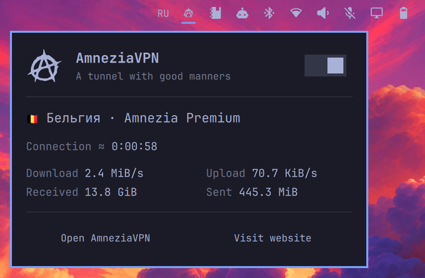
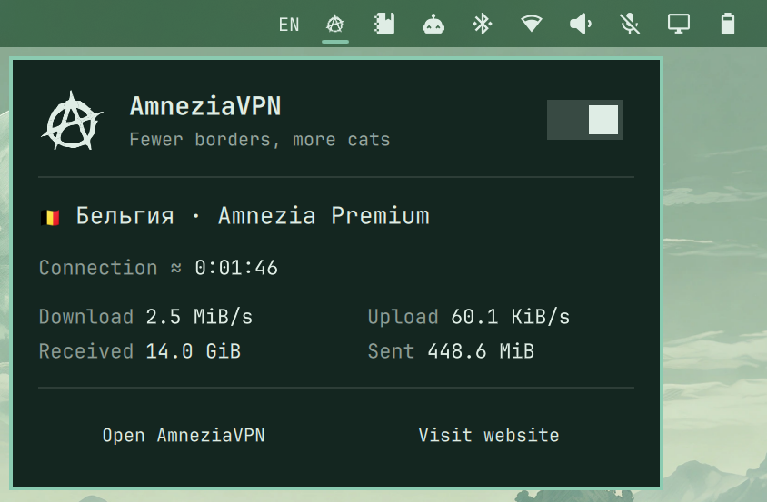

# [AmneziaVPN](https://amnezia.org/) for [Omarchy](https://omarchy.org/)

An unofficial Omarchy bar widget for the AmneziaVPN desktop application.
Control your connection, see the selected destination, and check VPN traffic
without opening the application. 
Plugin ID: `jmihbay.amneziavpn`.


## Features

- Theme-aware monochrome bar icon: full brightness when connected, dimmed and
  crossed out when disconnected, pulsing during transitions, faint when the app
  is not running. Pulsing respects Omarchy's animation setting.
- Connection switch in the card header; right-click the bar icon to connect or
  disconnect directly.
- Display the profile and country selected in AmneziaVPN, with a country flag.
  Display only: the widget cannot change the profile or country.
- Observed connection duration, download/upload rates and received/sent totals.
- Open or start AmneziaVPN and invoke its native “Visit website” tray action.
- Localized interface following the Omarchy language automatically (see Languages below).
- Rotating header captions while the card is open.





## Requirements

- Omarchy with its Quickshell shell and the `qs.Ui` plugin kit, including
  `ToggleSwitch`, `PanelSeparator` and the Qt Quick Effects module.
- AmneziaVPN desktop installed at `/opt/AmneziaVPN`; the launch action uses
  `/opt/AmneziaVPN/bin/AmneziaVPN`.
- AmneziaVPN tray menu in English or Russian for connection and tray actions.
- Python 3 for reading the selected profile's display fields.
- The `amn0` VPN interface for traffic statistics. Other interface names and
  VPN backends are not currently detected automatically.
- No compilation or custom installation script is required.

## Install from GitHub

```bash
omarchy plugin add https://github.com/jmihbay/omarchy-amneziavpn.git --enable
```

Update a git-managed installation:

```bash
omarchy plugin update jmihbay.amneziavpn
```

## Installation behavior

Installation, update and removal are handled by Omarchy's plugin manager.
This repository has no custom installer and does not automatically migrate
legacy plugin IDs, rewrite `shell.json`, replace occupied plugin directories
or rename old manifests/backups. If Omarchy reports an existing installation,
inspect it before deciding whether to update or remove it.

For development, edit your own repository checkout and validate it with the
commands below. Installation from GitHub is the supported installation path.

Omarchy normally reloads changed plugins automatically. If the old component
remains visible, run:

```bash
omarchy restart shell
```

The original AmneziaVPN tray icon is left in place.

## Use

Left-click the bar icon to open the card. Use the header switch or right-click
on the bar icon to connect/disconnect. AmneziaVPN must remain running for tray
controls; if it is closed, the card offers a launch button.

Keyboard controls follow Omarchy panels:

- Arrow keys or `h`/`j`/`k`/`l` move the highlight through available actions.
  Disabled actions and a busy connection switch are skipped.
- `Enter` or `Space` activates the highlighted action. No action is selected
  when the card first opens, preventing an accidental VPN toggle.
- `Escape` closes the card; `Tab` / `Shift+Tab` switches to the next/previous
  panel in the same bar section.
- Hovering an action updates the highlight; mouse clicks work as before.

Connection operations are not retried automatically. During an operation the
switch blocks repeat requests. After 30 seconds without the expected state,
the card asks you to check AmneziaVPN.

Disable or re-enable the widget without uninstalling it:

```bash
omarchy plugin disable jmihbay.amneziavpn
omarchy plugin enable jmihbay.amneziavpn
```

For an installation managed by Omarchy, removal is available with
`omarchy plugin remove jmihbay.amneziavpn`.

## Languages

The widget follows Omarchy's selected language. Catalogs are included for:

- English (`en`), Russian (`ru`), Spanish (`es-MX`), Brazilian Portuguese
  (`pt-BR`), German (`de`), French (`fr`), Simplified Chinese (`zh-CN`),
  Ukrainian (`uk`) and Uzbek (`uz`).
- Belarusian (`be`), Kazakh (`kk`), Azerbaijani (`az`), Armenian (`hy`),
  Georgian (`ka`), Kyrgyz (`ky`) and Tajik (`tg`) are prepared for hosts that
  support those language codes. They are not selectable in the installed
  Omarchy language list used during development.

New translations have not yet been reviewed by native speakers. Corrections
are welcome. This translates the widget's own labels and captions only.
AmneziaVPN's country/profile text is shown as supplied, and tray action
recognition remains limited to English and Russian AmneziaVPN menus.

## Data and limitations

The widget uses AmneziaVPN's D-Bus tray menu for actions and connection status.
This status is not an independent internet or tunnel health check. Unknown
menu translations disable the relevant controls rather than guessing actions.
The interface uses the catalogs listed below; missing translations fall back
to English. Country names come from Amnezia's saved settings and may use
a different language.

The selected profile and country are read from
`${XDG_CONFIG_HOME:-~/.config}/AmneziaVPN.ORG/AmneziaVPN.conf`.
These describe the saved selection, not a separately verified live endpoint.
To change the country or profile, use the AmneziaVPN application. The widget
only displays the saved selection; it does not offer country, profile or flag
selection. The flag is derived automatically from the country code.

The profile reader parses a settings file that can contain credentials, but
returns only the profile name, country name and country code. It does not log
credentials, change settings or contact Amnezia's API.

While the card is open:

- Kernel counters in `/sys/class/net/amn0/statistics/` are sampled once per
  second. Rates are calculated from successive samples, starting at zero
  after opening the card.
- The selected profile is refreshed every five seconds using a short-lived
  Python process. No additional Python packages are needed.

Traffic totals belong to the current VPN interface lifetime and can reset
when it is recreated. They are not persistent daily/monthly usage totals.
Unavailable counters appear as `—`. Connection duration starts when the widget
observes a connected state, resets when the shell restarts, and is marked `≈`.

The plugin does not make its own background network requests or require root.
Like other Omarchy shell plugins, it runs inside the user's shell process.
The website button invokes the application's existing action and may open a
browser.

## Validation

```bash
omarchy plugin validate .
bash -n scripts/lint.sh
bash scripts/lint.sh
```

The lint script maps Quickshell’s runtime `qs` namespace to the installed
Omarchy shell in a temporary import directory. It requires zero warnings and
does not disable diagnostic categories. Set `OMARCHY_PATH` or `QMLLINT` if
your installation uses different paths.

The widget has been manually checked on the author's system, including
connection controls, application restarts, themes and bar placement.
Compatibility with every AmneziaVPN release, protocol and installation layout
has not been established.

## License and attribution

GPL-3.0-only. See [LICENSE](LICENSE) and
[THIRD_PARTY_NOTICES.md](THIRD_PARTY_NOTICES.md).

Copyright (C) 2026 jmihbay for the original plugin code and documentation.
The included Amnezia logo is adapted from the AmneziaVPN client; it is not an
original design by this plugin's author. Amnezia names and branding belong to
their respective owners. This project is not affiliated with or endorsed by
AmneziaVPN.
