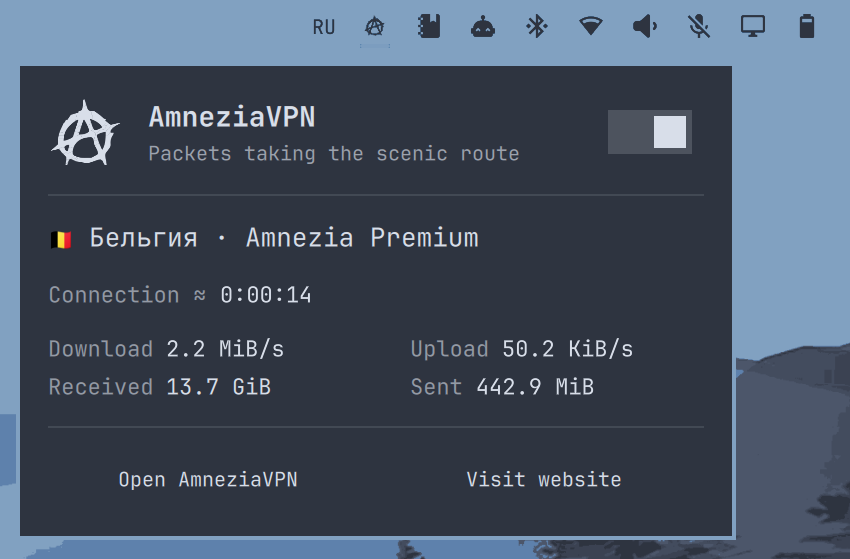
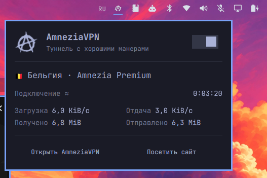

# AmneziaVPN for Omarchy

An unofficial Omarchy bar widget for the AmneziaVPN desktop application.
Control your connection, see the selected destination, and check VPN traffic
without opening the application. Plugin ID: `jmihbay.amneziaVPN`.



## Features

- Theme-aware monochrome bar icon: full brightness when connected, dimmed and
  crossed out when disconnected, pulsing during transitions, faint when the app
  is not running. Pulsing respects Omarchy's animation setting.
- Connection switch in the card header; right-click the bar icon to connect or
  disconnect directly.
- Selected profile, country and country flag.
- Observed connection duration, download/upload rates and received/sent totals.
- Open or start AmneziaVPN and invoke its native “Visit website” tray action.
- English and Russian interface, following the Omarchy language automatically.
- Rotating header captions while the card is open.



## Requirements

- Omarchy with its Quickshell shell and the `qs.Ui` plugin kit, including
  `ToggleSwitch`, `PanelSeparator` and the Qt Quick Effects module.
- AmneziaVPN desktop installed at `/opt/AmneziaVPN`; the launch action uses
  `/opt/AmneziaVPN/bin/AmneziaVPN`.
- AmneziaVPN tray menu in English or Russian for connection and tray actions.
- Python 3 for reading the selected profile's display fields.
- The `amn0` VPN interface for traffic statistics. Other interface names and
  VPN backends are not currently detected automatically.
- Bash and jq for the local installer; no compilation is required.

## Install from GitHub

```bash
omarchy plugin add https://github.com/jmihbay/omarchy-amneziavpn.git --enable
```

Update a git-managed installation:

```bash
omarchy plugin update jmihbay.amneziaVPN
```

## Install from a local checkout

Run from the plugin directory:

```bash
bash install.sh
```

The installer validates and copies the plugin into
`${XDG_CONFIG_HOME:-~/.config}/omarchy/plugins/jmihbay.amneziaVPN`.
A first installation enables the widget on the right side of the bar.
Subsequent runs preserve its position, settings and enabled/disabled state.
The installer also migrates the earlier `local.amnezia` and `j1z3.amneziaVPN` IDs in place and backs
up `shell.json` before that migration.

Omarchy normally reloads changed plugins automatically. If the old component
remains visible, run:

```bash
omarchy restart shell
```

The original AmneziaVPN tray icon is left in place.

## Use

Left-click the bar icon to open the card. Use the header switch or right-click
on the bar icon to connect/disconnect. AmneziaVPN must remain running for tray
controls; if it is closed, the card offers a launch button.

Connection operations are not retried automatically. During an operation the
switch blocks repeat requests. After 30 seconds without the expected state,
the card asks you to check AmneziaVPN.

Disable or re-enable the widget without uninstalling it:

```bash
omarchy plugin disable jmihbay.amneziaVPN
omarchy plugin enable jmihbay.amneziaVPN
```

For an installation managed by Omarchy, removal is available with
`omarchy plugin remove jmihbay.amneziaVPN`.

## Data and limitations

The widget uses AmneziaVPN's D-Bus tray menu for actions and connection status.
This status is not an independent internet or tunnel health check. Unknown
menu translations disable the relevant controls rather than guessing actions.
The interface has English and Russian catalogs; other Omarchy languages fall
back to English. Country names come from Amnezia's saved settings and may use
a different language.

The selected profile and country are read from
`${XDG_CONFIG_HOME:-~/.config}/AmneziaVPN.ORG/AmneziaVPN.conf`.
These describe the saved selection, not a separately verified live endpoint.
Country selection remains in the AmneziaVPN application.

The profile reader parses a settings file that can contain credentials, but
returns only the profile name, country name and country code. It does not log
credentials, change settings or contact Amnezia's API.

While the card is open:

- Kernel counters in `/sys/class/net/amn0/statistics/` are sampled once per
  second. Rates are calculated from successive samples, starting at zero
  after opening the card.
- The selected profile is refreshed every five seconds using a short-lived
  Python process. No additional Python packages are needed.

Traffic totals belong to the current VPN interface lifetime and can reset
when it is recreated. They are not persistent daily/monthly usage totals.
Unavailable counters appear as `—`. Connection duration starts when the widget
observes a connected state, resets when the shell restarts, and is marked `≈`.

The plugin does not make its own background network requests or require root.
Like other Omarchy shell plugins, it runs inside the user's shell process.
The website button invokes the application's existing action and may open a
browser.

## Validation

```bash
omarchy plugin validate .
bash -n install.sh
/usr/lib/qt6/bin/qmllint --unqualified disable -I /usr/share/omarchy/shell Panel.qml
```

The widget has been manually checked on the author's system, including
connection controls, application restarts, themes and bar placement.
Compatibility with every AmneziaVPN release, protocol and installation layout
has not been established.

## License and attribution

GPL-3.0-only. See [LICENSE](LICENSE) and
[THIRD_PARTY_NOTICES.md](THIRD_PARTY_NOTICES.md).

Copyright (C) 2026 jmihbay for the original plugin code and documentation.
The included Amnezia logo is adapted from the AmneziaVPN client; it is not an
original design by this plugin's author. Amnezia names and branding belong to
their respective owners. This project is not affiliated with or endorsed by
AmneziaVPN.
